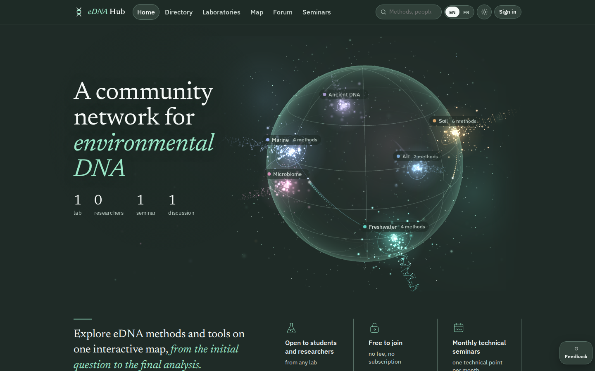
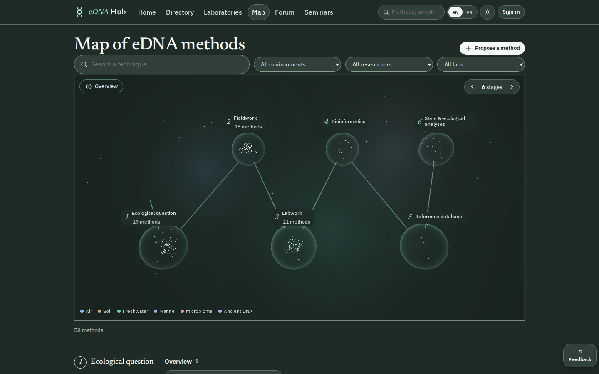
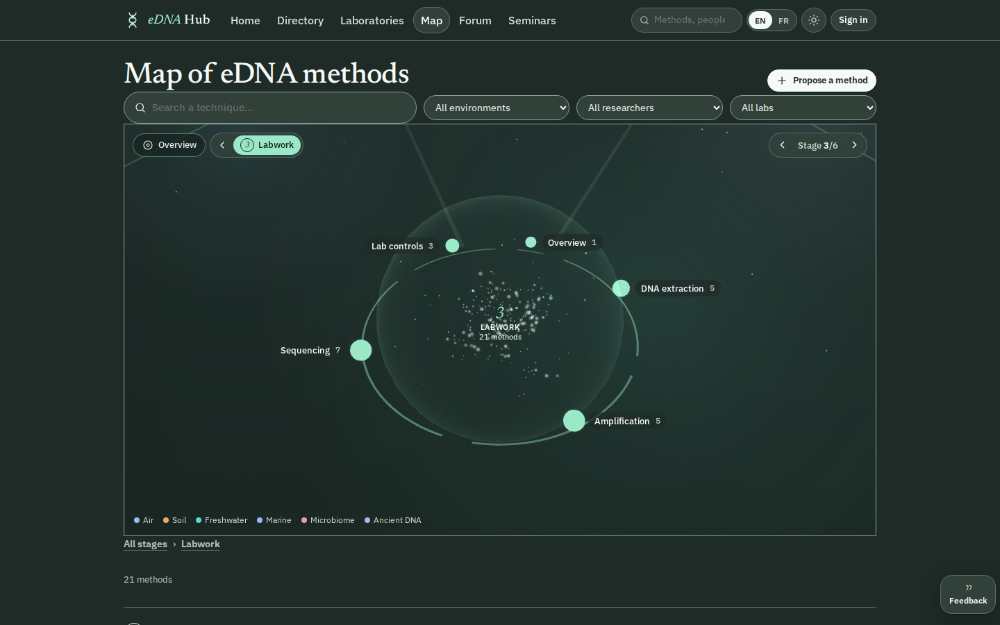
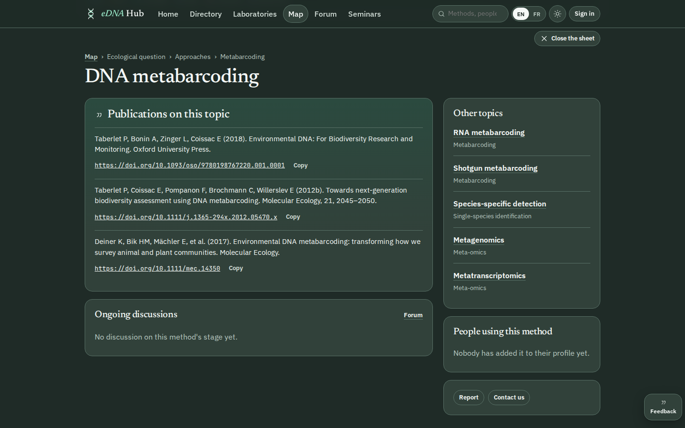
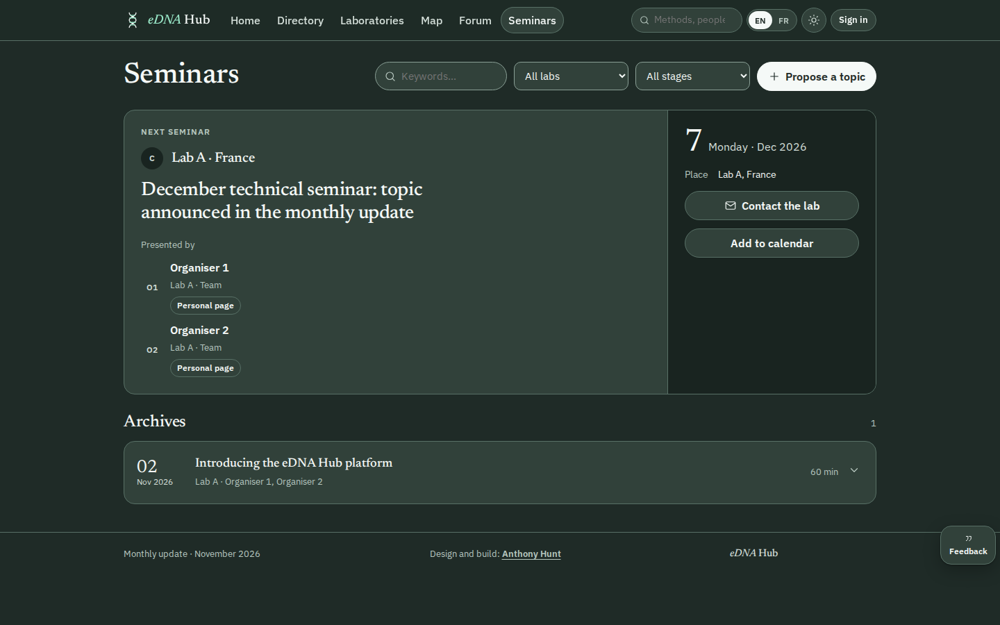
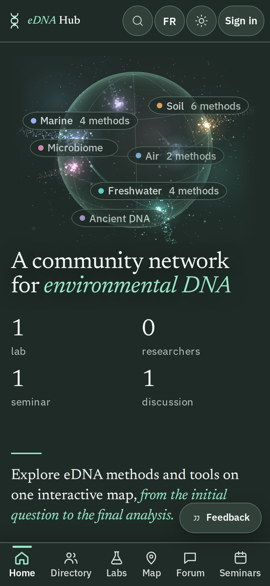

[English](README.md) · **Français**

**Anthony Hunt** · [Fiche du projet sur ingevision.cloud](https://ingevision.cloud/?p=edna-student-hub) · [LinkedIn](https://www.linkedin.com/in/anthony-hunt-3948a9196) · [Profil GitHub](https://github.com/anthohunt)

> Dépôt vitrine : le code et les données de ce projet sont privés ; ce README le décrit.

# eDNA Student Hub

Une web app pour les étudiants et chercheurs en ADN environnemental : qui fait quoi, à quelle étape du protocole, et à qui poser la question.

## Le problème

Dans les laboratoires de recherche, des doctorants travaillent sur l'ADN environnemental (ADNe) de l'air, du sol, de l'eau ou d'échantillons anciens. Chacun a ses méthodes, mais personne ne voit d'un coup d'œil qui utilise quoi. Le hub rassemble méthodes, profils, labos, discussions et séminaires en un seul endroit, consultable sans compte. Il est construit pour un laboratoire de recherche client, à qui le code appartiendra.

## Comment ça marche

- Tout projet d'ADNe suit six étapes : question écologique, terrain, labo, bio-informatique, base de référence, statistiques et analyses écologiques. Méthodes, membres, questions et séminaires sont rangés par étape et par milieu (air, sol, eau douce, marin, microbiome, ADN ancien).
- La carte des méthodes est le centre de l'appli : six stations sur un chemin ; un clic ouvre une étape en groupes, puis en méthodes ; chaque méthode a sa fiche, avec ses références et ses chiffres de littérature.
- Les visiteurs lisent tout ; un étudiant demande un accès, un gestionnaire de labo l'accepte depuis ses alertes, puis l'étudiant complète son profil (milieux, outils de la carte, publications par DOI ou importées d'ORCID).
- Les membres proposent des méthodes et posent des questions ; les gestionnaires valident et publient. Une mise à jour mensuelle (actualités, séminaire, chiffres OpenAlex) se fait depuis une console d'administration.
- L'appli a été construite avec ma pipeline de création de web apps : conception avec le client sur une maquette interactive, puis cinq jalons, chacun contrôlé par un vérificateur indépendant sur l'appli déployée.

## Ce qui est construit

Version 1, en ligne en version de test depuis le 10 novembre 2026, en attente des retours du client.

- 5 jalons sur 5, 87 histoires utilisateur : accueil et demandes d'accès ; carte, fiches et recherche ; personnes, labos et compte ; forum et séminaires ; console d'administration, mails et recette.
- Carte de 58 méthodes, importée du tableur du client, en 3D et en version sans 3D.
- Console d'administration : actualités, séminaires, rôles et droits, édition des textes, import du tableur, mise à jour du mois, OpenAlex et ORCID.
- Anglais et français, thème sombre ou clair, utilisable au téléphone (contrôlé à 1280, 390 et 360 px de large).
- 89 tests automatiques ; la matrice des droits vérifiée cas par cas (322 sur 322) ; sept scénarios de recette joués de bout en bout.
- Pas encore actif : l'envoi des mails (ils sont mis en file tant que l'adresse d'expédition n'est pas choisie).

| Carte : les six étapes | Carte : une étape ouverte en méthodes |
|---|---|
|  |  |

| Fiche d'une méthode | Séminaires (noms masqués) |
|---|---|
|  |  |

Les captures montrent l'interface en anglais ; l'appli existe aussi en français.

## Ce qui est public

Cette page et la version de test de l'appli : https://ingevision.cloud/edna/app/ . Le code appartient au labo client et reste privé. Sur les captures, les noms du labo et des personnes sont masqués.

## Pile technique

- React 19, TypeScript, Vite, React Router
- Three.js pour le globe 3D et la carte
- Supabase (PostgreSQL, authentification, droits par ligne, stockage), hébergé dans l'UE
- ORCID, Crossref et OpenAlex comme sources de données
- Vitest et Playwright pour les tests
- Hébergement statique derrière nginx et Traefik
