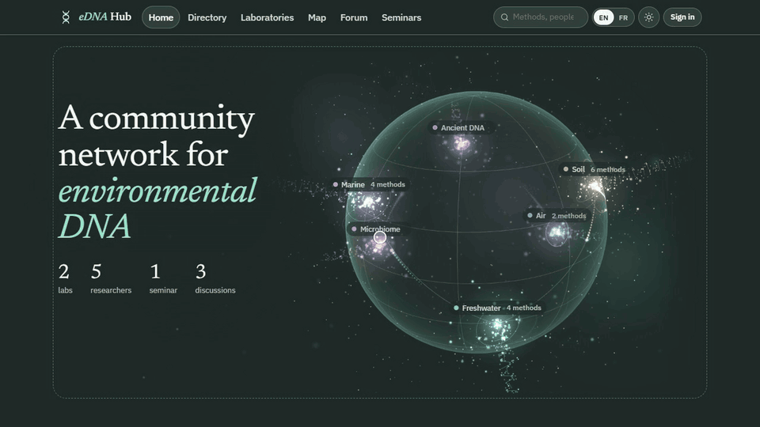

[English](README.md) · **Français**

# eDNA Student Hub

**Une carte partagée des méthodes de l'ADN environnemental, et des chercheurs qui les utilisent.** Étudiants et labos voient qui utilise quoi, à quelle étape du protocole, et à qui poser la question.

*Vraie utilisation de la version de test, avec des données de démonstration : les personnes et les labos montrés sont fictifs. [Vidéo complète (1 min 28)](https://drive.google.com/file/d/1SRzqDCk7krNjmo-yMZ6l9-5I63kjwFhW/view)*

## Utilisation

- **Carte des méthodes.** Six étapes, de la question écologique aux statistiques. Un clic ouvre une étape, puis un groupe de méthodes, puis la fiche d'une méthode avec ses articles de référence.
- **Filtres.** Par milieu (air, sol, eau douce, marin, microbiome, ADN ancien), par chercheur ou par labo.
- **Personnes et labos.** Un annuaire des chercheurs avec les méthodes qu'ils utilisent, et une page par labo.
- **Forum et séminaires.** Questions rangées par étape ; séminaires mensuels, avec un fichier d'agenda à télécharger.
- **Comptes.** La lecture se fait sans compte. Un étudiant demande l'accès, un responsable de labo l'accepte ; les membres proposent des méthodes, les responsables les valident.
- **Console d'administration.** Actualités, séminaires, rôles et droits, import du tableur, et le décompte mensuel de la littérature sur OpenAlex.

## Architecture

## Exploitation

- **Version.** Version de test en ligne depuis le 10 novembre 2026, non indexée, en attente des retours du labo.
- **Hébergement.** Fichiers statiques derrière nginx sur mon VPS ; Supabase (PostgreSQL, comptes, fichiers) dans l'UE.
- **Pas encore actif.** Les mails sortants restent en file tant que l'adresse d'expédition n'est pas choisie.
- **Vérifications.** 89 tests automatiques ; les droits de chaque rôle vérifiés un par un (322 sur 322) ; ordinateur et téléphone.
- **Technologies.** React 19, TypeScript, Vite, Three.js, Supabase.

---

**Anthony Hunt** · [ingevision.cloud](https://ingevision.cloud/?p=edna-student-hub) · [LinkedIn](https://www.linkedin.com/in/anthony-hunt-3948a9196) · [GitHub](https://github.com/anthohunt)

Le code et les données du labo sont privés.
