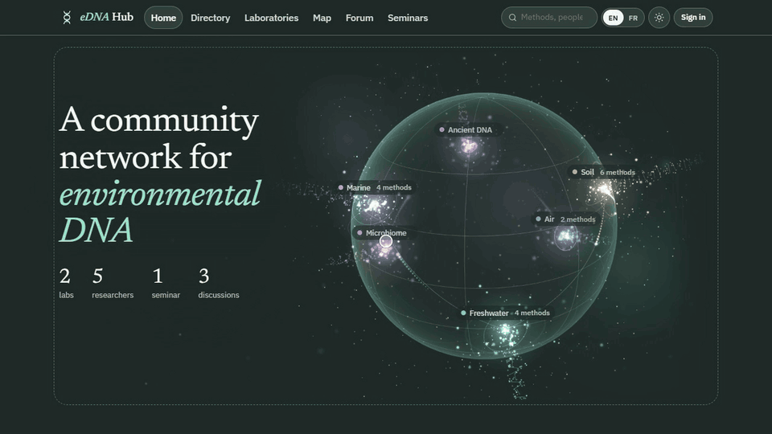
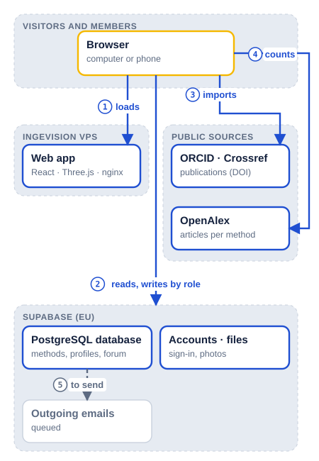

**English** · [Français](README.fr.md)

# eDNA Student Hub

**A shared map of environmental DNA methods, and of the researchers who use them.**

*People and labs shown are fictional. [Full video (1:28)](https://drive.google.com/file/d/1SRzqDCk7krNjmo-yMZ6l9-5I63kjwFhW/view)*

## Using it

- **Map of methods.** Six stages, from the ecological question to the statistics. A click opens a stage, then a group of methods, then a method sheet with its reference papers.
- **Filters.** By environment (air, soil, freshwater, marine, microbiome, ancient DNA), by researcher or by lab.
- **People and labs.** A directory of researchers with the methods they use, and a page per lab.
- **Forum and seminars.** Questions filed by stage; monthly seminars, with a calendar file to download.
- **Accounts.** Reading needs no account. A student requests access, a lab manager accepts; members propose methods, managers validate them.
- **Admin console.** News, seminars, roles and rights, spreadsheet import, and the monthly literature count from OpenAlex.

## Architecture

## Deployment

- **Version.** Test version online since 10 November 2026, not indexed, waiting for the lab's feedback.
- **Hosting.** My VPS for the web app, Supabase in the EU for the data.
- **Not active yet.** Outgoing emails stay in a queue until a sending address is chosen.
- **Checks.** 89 automated tests; every action tested for every role; computer and phone.

---

**Anthony Hunt** · [ingevision.cloud](https://ingevision.cloud/?lang=en&p=edna-student-hub) · [LinkedIn](https://www.linkedin.com/in/anthony-hunt-3948a9196) · [GitHub](https://github.com/anthohunt)

The code is private.
