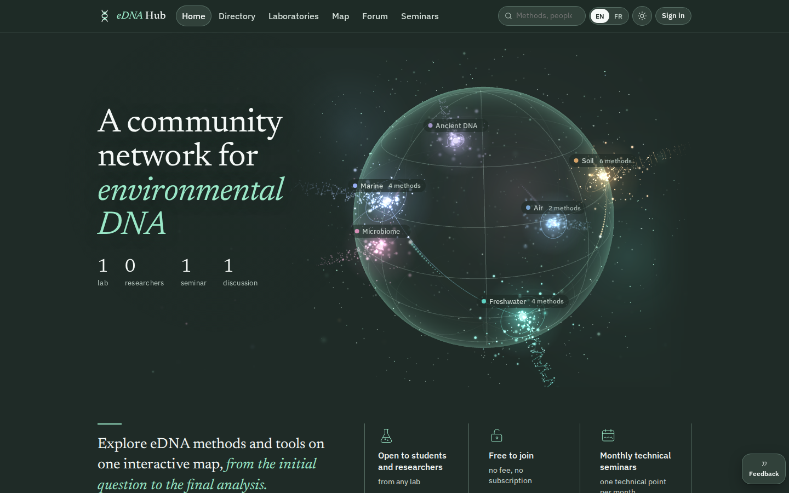
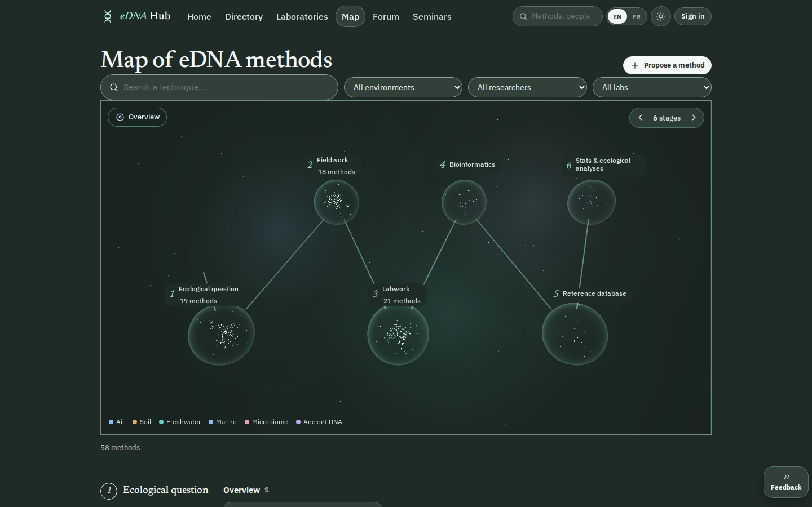
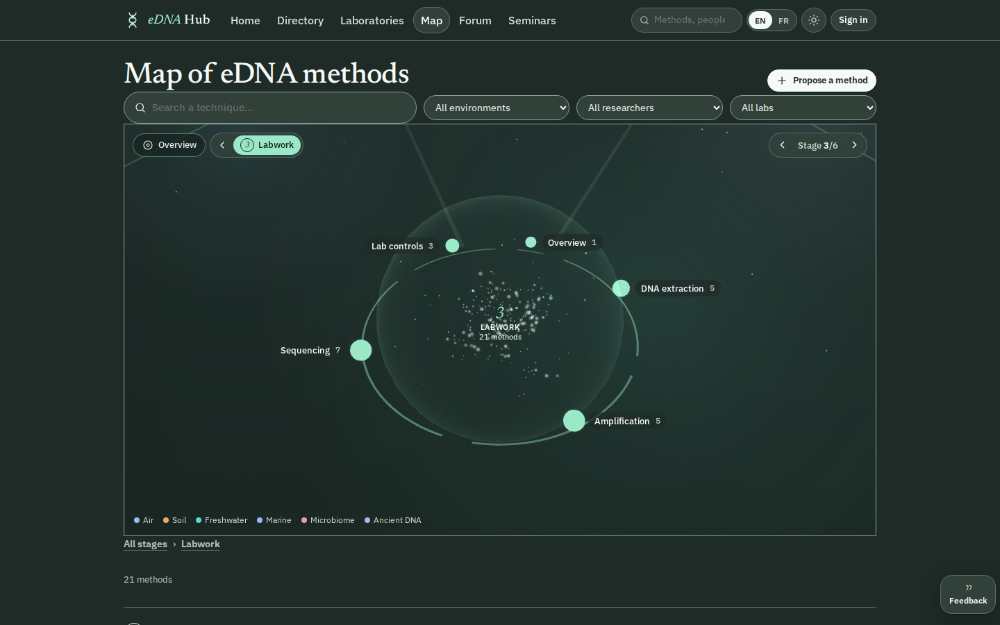
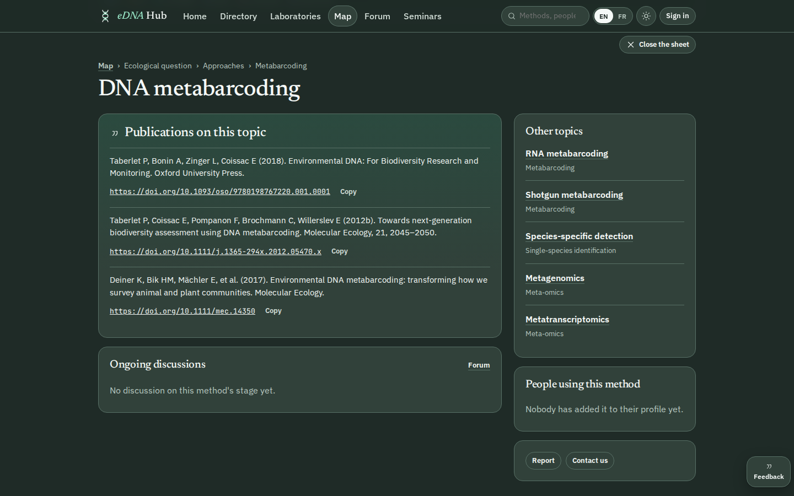
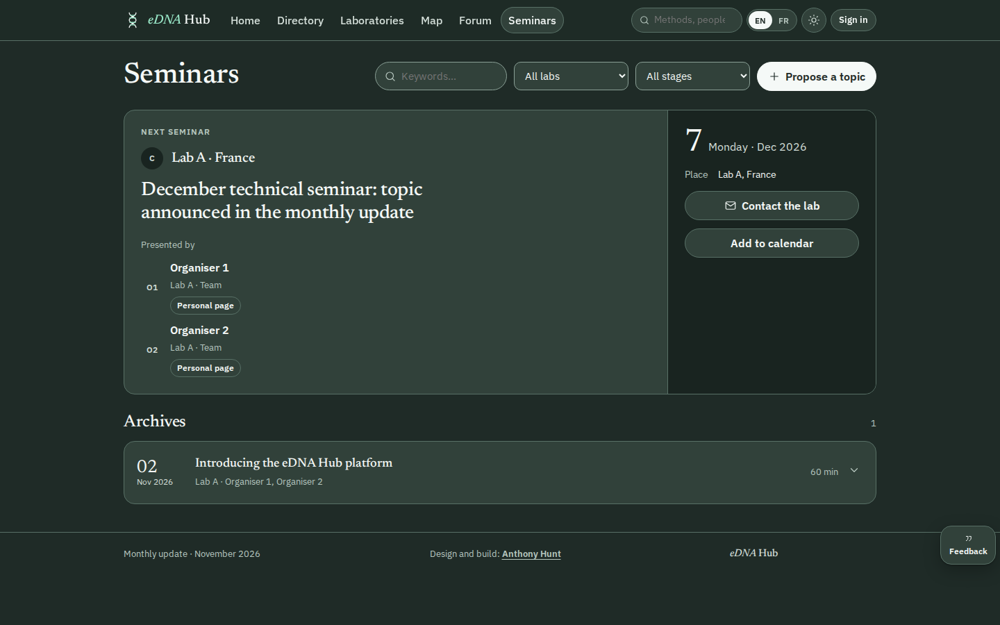
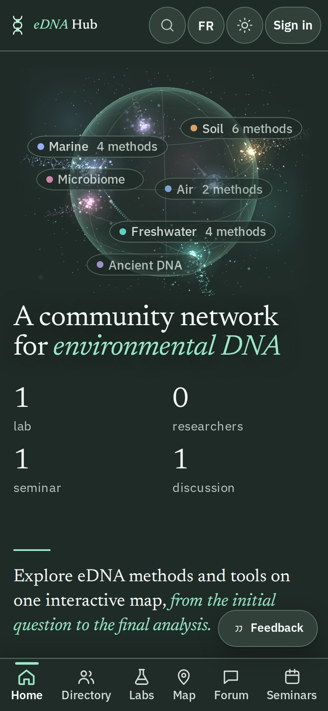

**English** · [Français](README.fr.md)

**Anthony Hunt** · [Project page on ingevision.cloud](https://ingevision.cloud/?lang=en&p=edna-student-hub) · [LinkedIn](https://www.linkedin.com/in/anthony-hunt-3948a9196) · [GitHub profile](https://github.com/anthohunt)

> Showcase repository: the code and data of this project are private; this README describes it.

# eDNA Student Hub

A web app for students and researchers working on environmental DNA: who works on what, at which stage of the protocol, and who to ask.

## The problem

In research labs, PhD students work on environmental DNA (eDNA) from air, soil, water or ancient samples. Each one has their own methods, but nobody can see at a glance who uses what. The hub gathers methods, profiles, labs, discussions and seminars in one place, readable without an account. It is built for a client research lab, which will own the code.

## How it works

- Every eDNA project follows six stages: ecological question, fieldwork, labwork, bioinformatics, reference database, stats and ecological analyses. Methods, members, questions and seminars are filed by stage and by environment (air, soil, freshwater, marine, microbiome, ancient DNA).
- The map of methods is the centre of the app: six stations on a path; a click opens a stage into its groups, then into methods; each method has a sheet with its references and literature counts.
- Visitors read everything; students request access, a lab manager accepts it from their alerts, then the student completes a profile (environments, tools from the map, publications by DOI or imported from ORCID).
- Members propose methods and ask questions; lab managers validate and publish. A monthly update (news, seminar, literature counts from OpenAlex) is run from an admin console.
- The app was built with my web app pipeline: design with the client on an interactive mockup, then five milestones, each one checked by an independent verifier on the deployed app.

## What is built

Version 1, online as a test version since 10 November 2026, waiting for the client's feedback.

- 5 milestones out of 5, 87 user stories: home and access requests; map, method sheets and search; people, labs and account; forum and seminars; admin console, emails and acceptance run.
- Map of 58 methods, imported from the client's spreadsheet, with a 3D view and a version without 3D.
- Admin console: news, seminars, roles and rights, text editing, spreadsheet import, monthly update, OpenAlex and ORCID.
- English and French, dark and light theme, usable on a phone (checked at 1280, 390 and 360 px wide).
- 89 automated tests; the rights matrix checked case by case (322 out of 322); seven acceptance scenarios played end to end.
- Not active yet: outgoing emails (they are queued until the sending address is chosen).

| Map: the six stages | Map: a stage opened into methods |
|---|---|
|  |  |

| Method sheet | Seminars (names masked) |
|---|---|
|  |  |

## What is public

This page and the test version of the app: https://ingevision.cloud/edna/app/ . The code belongs to the client lab and stays private. In the screenshots above, the names of the lab and of people are masked.

## Tech stack

- React 19, TypeScript, Vite, React Router
- Three.js for the 3D globe and the map
- Supabase (PostgreSQL, authentication, row-level security, storage), hosted in the EU
- ORCID, Crossref and OpenAlex as data sources
- Vitest and Playwright for the tests
- Static hosting behind nginx and Traefik
